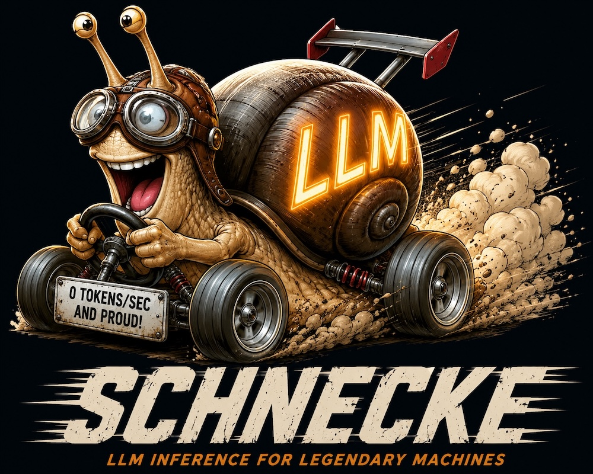
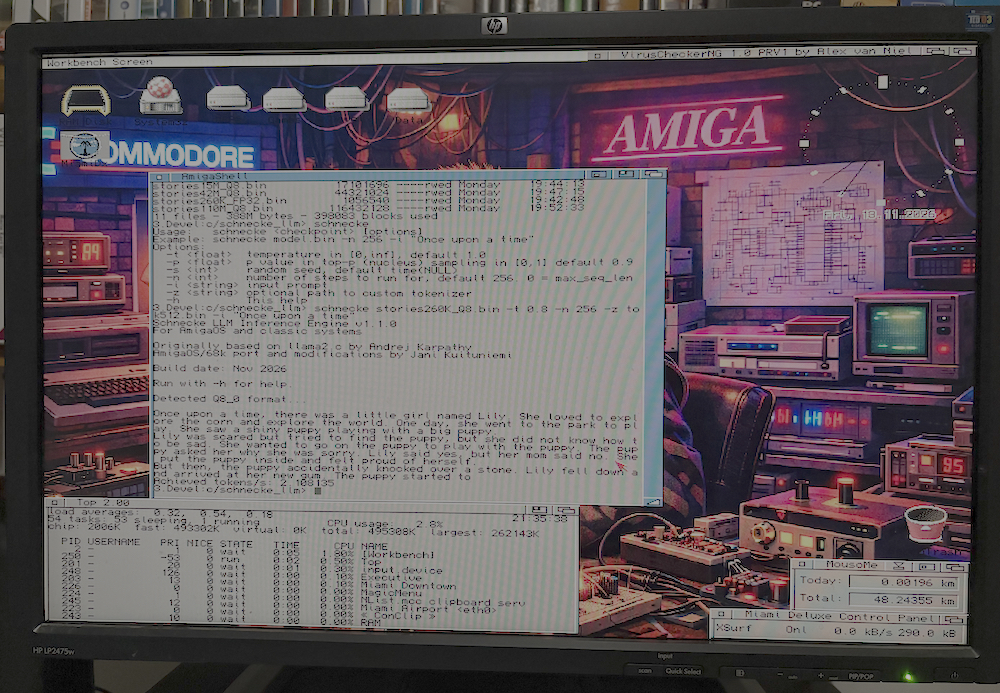

# Schnecke LLM

Schnecke is a portable C89-based LLM inference engine for AmigaOS and classic systems, based on Andrej Karpathy’s llama2.c. It was created primarily as an experiment to see whether modern transformer inference could be made to run locally on vintage 68k Amiga hardware.

*"Because sometimes the question is not whether something should be done, but whether it could be done."*

## Features

* Portable, single-file C89 codebase
* AmigaOS / Motorola 68k compatible
* Big-endian compatibility
* FP32 and Q8_0 quantized inference support
* Compatible with llama2.c model and tokenizer formats
* Minimal dependencies
* Based on Andrej Karpathy's llama2.c

## Why?

Schnecke began primarily as an experiment into local AI inference on classic hardware. The goal was not speed or practicality, but understanding what modern transformer inference fundamentally requires and how it actually works under the hood. Schnecke has been very valuable as an educational tool and journey. While Schnecke was developed primarily for AmigaOS and Motorola 68k systems, an effort was made to keep the code portable and dependency-light using mostly old-style C89-compatible code. Especially some old UNIX workstations would be an interesting target as they often have quite reasonable amount of CPU power but are similarly to the Amiga constrained by old versions of GCC compiler or even use the old K&R C compiler.

## Screenshot

## Requirements

Schnecke was developed primarily for classic Amiga hardware, although it should compile and run on other systems with a sufficiently compatible C compiler. Actual memory requirements depend on the model and precision used.

### Hardware

* Motorola 68k processor (68060 strongly recommended)
* Sufficient RAM for the selected model and its runtime buffers
* Accelerator-local Fast RAM highly recommended for best performance
* Coffee

### Software

* AmigaOS 3.x (for Amiga builds)
* GCC 2.95+ or another sufficiently C89-compatible compiler
* Standard C library and libm for building
* Patience

## Building

*`gcc -noixemul -std=c89 -O2 schnecke.c -lm -o schnecke`*

Compiler optimization flags such as -O2 are strongly recommended due to the computational cost of inference on classic hardware.

## Running

To run Schnecke, you need both the actual model as well as the Tokenizer. To get the model, try downloading stories15M model from huggingface;

    wget https://huggingface.co/karpathy/tinyllamas/resolve/main/stories15M.bin

Other llama2.c-compatible models in both FP32 and Q8_0 formats have also been tested successfully, provided sufficient RAM is available and patience to go with it. Andrej hosts a number of smaller and bigger models on his page.

And for the Tokenizer, use the one from Andrej's repository here;

    https://github.com/softmax1/llama2.c-tinystories

Once those are in place in the same directory where you downloaded Schnecke to, you can run using for example the following command;

    schnecke stories15M.bin -t 0.8 -n 256 -i "Once upon a time"

You should receive something like this;

> Once upon a time there was a little girl named Lily. She loved to play with her toys and her friends. One day, Lily and her friends decided to have a race. They ran and ran until they reached a big tree. They were both very competitive and wanted to win. Lily's friend, Timmy, said, "I bet I can run faster than you!" but Lily replied, "I'm not the fastest, I'm just tall enough to beat you!" They both started to run as fast as they could. As they were running, Lily accidentally bumped into a small boy named Max. Max got upset and started to cry. Lily said, "I'm sorry, Max. I didn't mean to bump into you. Let's be friends and play together." Max stopped crying and smiled. From that day on, they were the best of friends and always played together.

## Parameters:

* -t : Temperature in [0,inf], default 1.0
* -p : p value in top-p (nucleus) sampling in [0,1] default 0.9
* -s : Random seed, default time(NULL)
* -n : Number of steps to run for, default 256. 0 = max_seq_len
* -z : Optional path to custom tokenizer, default $PROGDIR
* -h : Prints Help.

## Model Formats

Schnecke supports the original llama2.c-compatible checkpoint format in both FP32 and Q8_0 quantized variants.

Models can be used directly if they are already in a compatible format, or converted using the export and quantization utilities provided by Andrej Karpathy's original llama2.c project. These utilities have also been used to produce the Q8_0 checkpoints tested with Schnecke.

Schnecke has been tested with TinyStories models ranging from 260K to 110M parameters in both FP32 and Q8_0 formats.

A compatible tokenizer file is also required for text generation.

## Quantization Support

Schnecke 1.1.0 introduces support for Q8_0 quantized inference alongside the original FP32 implementation.

The implementation was inspired by Andrej Karpathy's `runq.c`, but rather than directly porting and merging its code, Q8_0 support was integrated into Schnecke's existing inference engine. The goal was to preserve the portable, single-file C89 architecture while sharing as much of the inference code as possible between FP32 and quantized models.

Q8_0 uses 8-bit signed integers to represent model weights, significantly reducing their memory footprint compared to FP32. Each group of quantized weights has an associated FP32 scaling factor, allowing the original approximate weight values to be reconstructed during computation.

During inference, activation vectors are also quantized to 8-bit integers. Matrix multiplication then uses integer dot products, with the corresponding FP32 scaling factors applied to produce the final floating-point results.

Besides the significant reduction in memory requirements, quantization can also improve inference performance, particularly on older processors where integer arithmetic may be more efficient than floating-point operations. The smaller model footprint can also reduce memory bandwidth requirements, which can be especially beneficial on vintage hardware.

The implementation also handles quantization groups that cross matrix row boundaries, as well as partial groups where vector dimensions are not evenly divisible by the group size. This ensures correct operation with the checkpoint layouts produced by the original `llama2.c` quantization utilities.

Both FP32 and Q8_0 models use the same transformer inference pipeline, with precision-specific routines handling the necessary differences in weight representation and matrix multiplication.

## Endianness Support

Schnecke supports both little-endian and big-endian systems, allowing the same compatible model checkpoints to be used across different hardware architectures.

When necessary, byte-order conversion is performed automatically during checkpoint loading, ensuring that model weights and associated data are correctly interpreted by the host system.

This conversion is performed only during loading, avoiding additional byte-swapping overhead during inference.

## Benchmarks

Schnecke is not intended to be fast. Its purpose is experimentation, portability and technical curiosity. The following benchmarks illustrate inference performance across several model sizes, precision formats and hardware configurations.

All results are measured in tokens per second (tokens/s). Higher values indicate faster inference.

### Amiga 4000 / Motorola 68060

Benchmarks performed on a physical Amiga 4000 equipped with a CyberStorm Mk II 68060 accelerator. Amiga binary compiled with the following compiler options:

*`gcc -noixemul -std=c89 -O2 -m68060 schnecke.c -lm -o schnecke`*

| Model | FP32 (tokens/s) | Q8_0 (tokens/s) |
|---|---:|---:|
| TinyStories 260K | 2.100494 | 2.058444 |
| TinyStories 15M | 0.157319 | 0.158210 |
| TinyStories 42M | 0.033661 | 0.079628 |
| TinyStories 110M | N/A * | 0.032935 |

\* The 110M FP32 model could not be tested on the physical Amiga due to the lack of a sufficiently large contiguous memory region.

### FS-UAE / Emulated Motorola 68060

Benchmarks performed using FS-UAE on a Mac Mini M2 Pro, with JIT compilation enabled and disabled.

| Model | FP32 (No JIT) | Q8_0 (No JIT) | FP32 (JIT) | Q8_0 (JIT) |
|---|---:|---:|---:|---:|
| TinyStories 260K | 4.550321 | 4.786036 | 9.984338 | 11.87508 |
| TinyStories 15M | 0.272410| 0.320005 | 0.436053 | 0.714089 |
| TinyStories 42M | 0.101899| 0.127098 | 0.176897 | 0.331862 |
| TinyStories 110M | 0.026209 | 0.060745 | 0.068410 | 0.135345 |

### Apple Silicon / Mac Mini M2 Pro

Native benchmarks on a modern Apple Silicon system, included primarily as a portability and performance reference.

| Model | FP32 (tokens/s) | Q8_0 (tokens/s) |
|---|---:|---:|
| TinyStories 260K | 4553.571429 | 4047.619048 |
| TinyStories 15M | 121.480709 | 180.277350 |
| TinyStories 42M | 35.212701 | 70.986381 |
| TinyStories 110M | 12.103439 | 26.998186 |

A dash indicates a configuration that was not benchmarked.

### Memory Requirements

| Model | FP32 RAM | Q8_0 RAM |
|---|---:|---:|
| TinyStories 260K | — | ~1 MB |
| TinyStories 15M | ~64 MB | ~23 MB |
| TinyStories 42M | ~202 MB | ~77 MB |
| TinyStories 110M | ~492 MB | ~184.5 MB |

Memory figures represent approximate observed runtime usage while running on the Amiga. The figures include model weights and runtime allocations, rather than checkpoint file sizes alone. Actual memory requirements may vary by platform and configuration.

Quantization provides significant memory savings and can improve inference performance on vintage hardware. In particular, the smaller memory footprint may allow models to fit into faster accelerator-local RAM, reducing reliance on slower expansion memory.

## Known Limitations

* Supports only llama2.c-compatible model architectures and checkpoint formats.

## Future Ideas

* Q4 quantization support
* Limited interactive chat mode

## Version History

**v1.1.0 — November 2026**
* Added Q8_0 quantized inference support.
* Internal refactoring and improvements.
* Fixed several potential bugs.

**v1.0.0 — May 2026**
* Initial AmigaOS / Motorola 68k port of llama2.c.
* Added big-endian compatibility.

## Credits

Schnecke is based heavily on Andrej Karpathy's excellent `llama2.c` project, with Q8_0 quantization support inspired by his `runq.c` implementation.

Original project:
https://github.com/karpathy/llama2.c

OpenAI's ChatGPT was used as a research and development assistant, helping with implementation discussions, debugging, code review and technical documentation.

## License

Schnecke is licensed under the MIT License.

See LICENSE for details.
